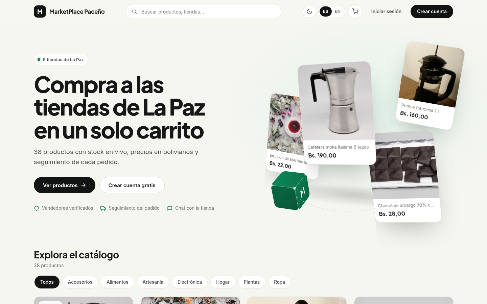
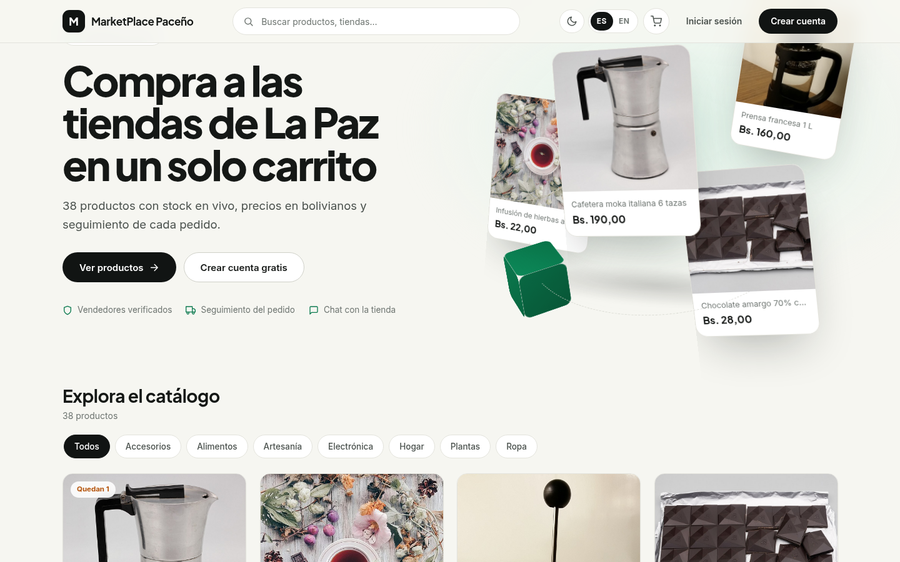
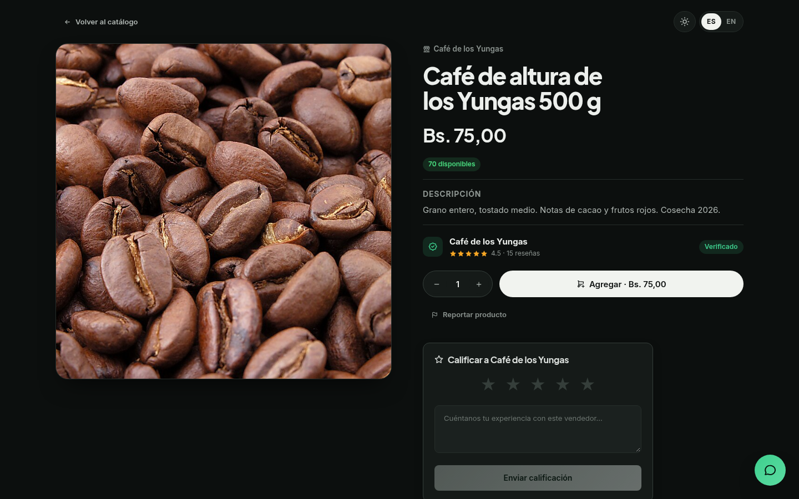
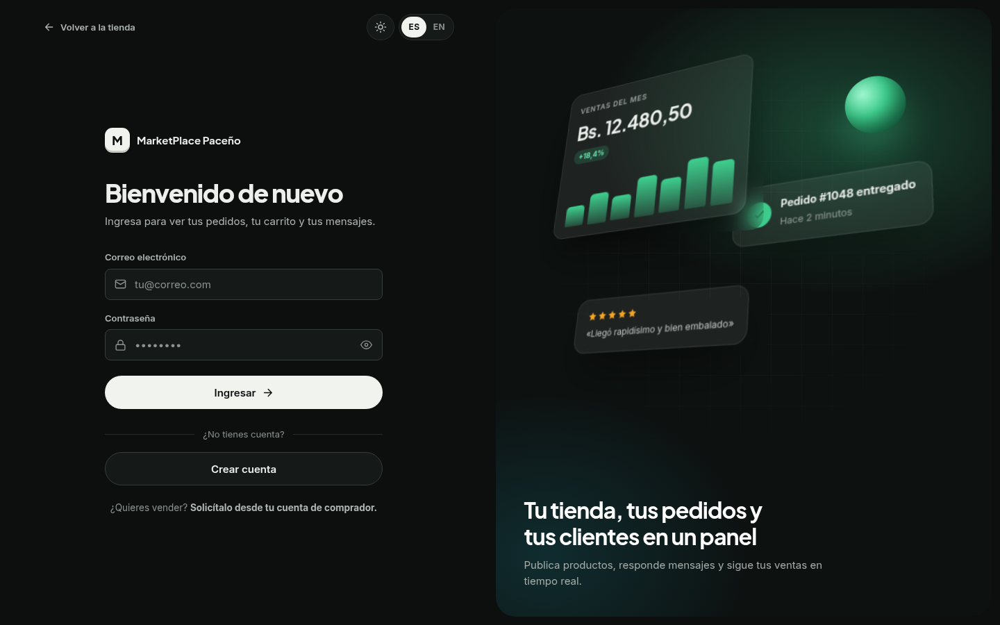
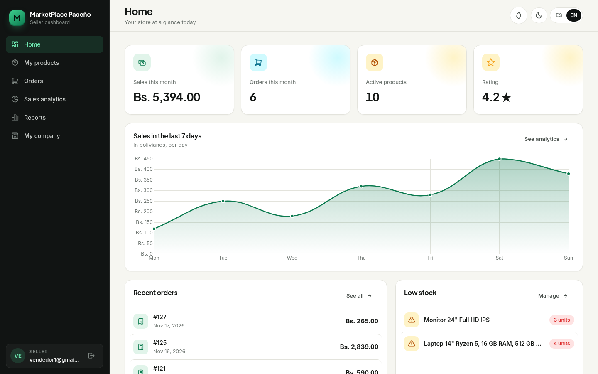
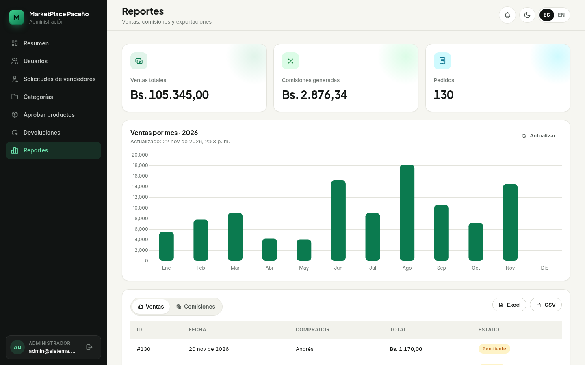
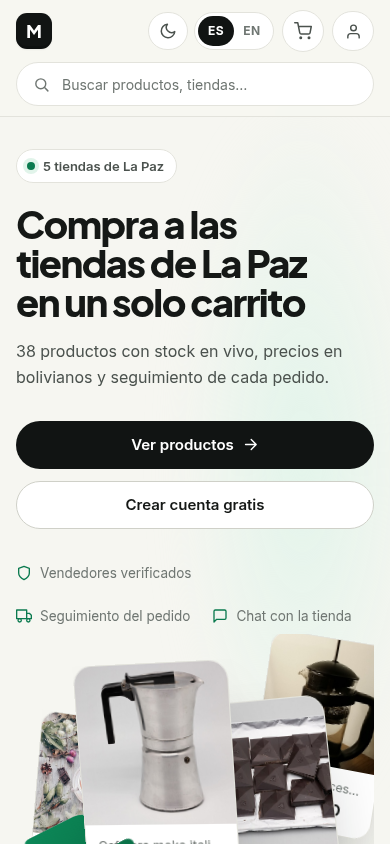

# MarketPlace Paceño — Sistema Vendedor

Marketplace web multivendedor: varias tiendas de La Paz publican sus productos y los compradores
compran a todas desde un solo carrito. Tiene tres roles, cada uno con su propio panel:
**comprador**, **vendedor** y **administrador**.

> Proyecto universitario de la materia **Taller Técnico Superior**, liderado por
> [@amamemie](https://github.com/amamemie).

🇬🇧 [Read in English](README.md)

### 👉 [Ver la demo en vivo](https://amamemie.github.io/sistema-vendedor/)



## Índice

- [Demo en línea](#demo-en-línea)
- [Qué hace](#qué-hace)
- [Tecnologías](#tecnologías)
- [Capturas](#capturas)
- [Cómo ejecutarlo](#cómo-ejecutarlo)
- [Cuentas de prueba](#cuentas-de-prueba)
- [Estructura del proyecto](#estructura-del-proyecto)
- [Base de datos](#base-de-datos)
- [Limitaciones conocidas](#limitaciones-conocidas)
- [Créditos](#créditos)

## Demo en línea

**<https://amamemie.github.io/sistema-vendedor/>**

La demo está publicada en GitHub Pages, que solo sirve archivos estáticos. Por eso no usa el backend PHP:
trae una copia de los datos de demostración y un backend simulado en el navegador (`src/demo/`).

- Se puede recorrer todo con las [cuentas de prueba](#cuentas-de-prueba): catálogo, carrito, checkout y los
  paneles de comprador, vendedor y administrador, con sus gráficas y reportes (PDF y Excel incluidos).
- Las acciones que modifican datos (crear productos, cambiar estados, aprobar…) responden, pero **no se guardan**.
- Las fechas se desplazan solas para que la actividad reciente siempre parezca de esta semana.

Para la versión completa, con base de datos, sigue [Cómo ejecutarlo](#cómo-ejecutarlo).

## Qué hace

### Visitante (sin cuenta)
- Recorre el catálogo público, busca productos y los filtra por categoría.
- Arma un carrito. Al pagar se le pide iniciar sesión o registrarse, y el carrito se conserva.

### Comprador
- Ve el detalle de cada producto: fotos, stock, descripción y calificación de la tienda.
- Carrito con cantidades, códigos de descuento y checkout con tarjeta, QR o transferencia (el pago es simulado).
- **Mis pedidos**: sigue el estado de cada pedido, cancela los pendientes y pide devoluciones.
- Califica a los vendedores, reporta productos y chatea con la tienda.
- Mis reseñas, mis descuentos y una opción para **solicitar ser vendedor**.

### Vendedor
- Dashboard con ventas del mes, pedidos, productos activos, calificación y gráfica de los últimos 7 días.
- Gestión de productos (crear, editar, borrar, subir imágenes y controlar stock).
- Pedidos recibidos: los marca como *Enviado* o *Entregado* y chatea con el comprador.
- Análisis de ventas: productos más vendidos, mejores clientes (con opción de darles un descuento) y productos más cancelados.
- Reportes por rango de fechas y datos de la empresa.

### Administrador
- Resumen de la plataforma: ingresos y pedidos del mes, usuarios, vendedores y pendientes.
- Gestión de usuarios: cambiar el rol y **activar o desactivar cuentas** (una cuenta desactivada no puede iniciar sesión).
- Lista de vendedores y **alta directa de vendedores** con su tienda, ya aprobados.
- Gestión de categorías.
- Aprueba o rechaza productos antes de que aparezcan en el catálogo.
- Aprueba o rechaza las solicitudes de nuevos vendedores y las devoluciones.
- Reportes de ventas y comisiones (3% por venta) con gráfica mensual y exportación a **Excel** y **CSV**.
- Reportes detallados por rango de fechas (ganancias, vendedores, compradores y productos vendidos) con exportación a **PDF** y Excel.

### En toda la aplicación
- **Modo claro y oscuro**: recuerda la preferencia y, la primera vez, sigue la del sistema.
- **Español e inglés**: textos, fechas, moneda y encabezados de los Excel exportados.
- **Animaciones 3D**: escena 3D en la portada y en el inicio de sesión, tarjetas que se inclinan con el
  mouse y modales con profundidad. Se desactivan si el usuario tiene activado "reducir movimiento".
- **Diseño adaptable**: funciona desde 360 px de ancho, con menú tipo cajón en móvil.
- **Accesibilidad**: navegación por teclado con foco visible, enlace para saltar al contenido y botones con nombre para lectores de pantalla.

## Tecnologías

| Capa | Tecnología |
|---|---|
| Frontend | [React 19](https://react.dev) + [Vite 8](https://vite.dev) |
| Estilos | CSS propio con *design tokens* (variables CSS), sin framework; fuentes Inter y Plus Jakarta Sans; iconos [Tabler](https://tabler.io/icons) |
| Idiomas | [i18next](https://www.i18next.com) + react-i18next, con detección automática del idioma |
| Gráficas | [Chart.js](https://www.chartjs.org) + react-chartjs-2 |
| Exportación | [SheetJS (xlsx)](https://sheetjs.com) + file-saver (Excel/CSV), [jsPDF](https://github.com/parallax/jsPDF) + jspdf-autotable (PDF) |
| Backend | PHP 8 (API REST en archivos `.php`, respuestas JSON) con PDO |
| Base de datos | MySQL / MariaDB |
| Entorno local | XAMPP, o Docker con `docker-compose.yml` |
| Calidad | ESLint (reglas de React Hooks y React Refresh) |

## Capturas

| | |
|---|---|
|  |  |
| Catálogo con filtros por categoría | Detalle de producto (modo oscuro) |
|  |  |
| Inicio de sesión con panel 3D | Panel del vendedor (en inglés) |
|  |  |
| Reportes del administrador | Vista móvil |

## Cómo ejecutarlo

Necesitas [Node.js 20+](https://nodejs.org) para el frontend y un servidor PHP con MySQL para el backend.
El frontend busca la API en `http://localhost/sistema-vendedor/backend`, así que el proyecto
tiene que quedar servido en esa ruta.

### 1. Clonar e instalar

```bash
git clone https://github.com/amamemie/sistema-vendedor.git
cd sistema-vendedor
npm install
```

### 2. Backend y base de datos

**Opción A — XAMPP (Windows)**

1. Copia o enlaza la carpeta del proyecto en `C:\xampp\htdocs\sistema-vendedor`.
2. Inicia Apache y MySQL desde el panel de XAMPP.
3. En phpMyAdmin crea la base `sistema_ventas` e importa, en este orden:
   1. `sistema_ventass.sql` (tablas y datos base)
   2. `backend/seed/datos_demo.sql` (datos de demostración)
4. Si tu MySQL tiene contraseña, cámbiala en `backend/config.php`.

**Opción B — Docker (Linux / macOS / Windows)**

```bash
docker compose up -d --build
```

Esto levanta MariaDB, con los dos archivos SQL ya importados, y PHP + Apache en el puerto 80.
La base se crea solo la primera vez. Para empezar de cero, ejecuta `docker compose down -v`.

> En Linux, MySQL distingue mayúsculas en los nombres de tabla y el código usa `PRODUCTO`, `COMPRA`, etc.
> Por eso el `docker-compose.yml` arranca MariaDB con `--lower-case-table-names=1`. En XAMPP para Windows no hace falta.

Comprueba que el backend responde: <http://localhost/sistema-vendedor/backend/categorias.php>

### 3. Frontend

```bash
npm run dev
```

Abre <http://localhost:5173>.

Otros comandos:

```bash
npm run build          # compila a dist/
npm run preview        # sirve la versión compilada
npm run lint           # revisa el código con ESLint
npm run build:demo     # compila la demo estática (sin backend) para GitHub Pages
npm run preview:demo   # prueba la demo en http://localhost:4173/sistema-vendedor/
npm run demo:snapshot  # actualiza los datos de la demo desde el backend local
```

### Publicar la demo en GitHub Pages

El flujo `.github/workflows/deploy-pages.yml` compila y publica la demo en cada push a `main`.
Solo hay que activarlo una vez: **Settings → Pages → Build and deployment → Source: GitHub Actions**.

Si cambian los datos o las rutas del backend, ejecuta `npm run demo:snapshot` con el backend local
corriendo y haz commit de `src/demo/snapshot.json`.

## Cuentas de prueba

Vienen en los datos de demostración.

| Rol | Correo | Contraseña |
|---|---|---|
| Administrador | `admin@sistema.com` | `hash_admin_123` |
| Vendedor (TecnoMundo) | `vendedor1@gmail.com` | `hash_vend_1` |
| Vendedora (ModaExpress) | `vendedor2@gmail.com` | `hash_vend_2` |
| Vendedora (Verde Andino) | `gabriela.rojas@ejemplo.com` | `123456` |
| Comprador | `comprador1@hotmail.com` | `hash_comp_1` |
| Compradora | `bien@gmail.com` | `123456` |

## Estructura del proyecto

```
sistema-vendedor/
├── backend/                  API en PHP (un archivo por endpoint)
│   ├── config.php            conexión PDO y cabeceras CORS
│   ├── productos.php, comprar.php, pedidos_vendedor.php, reporte_ventas.php, …
│   ├── seed/                 generador de datos de demostración
│   │   ├── generar_datos_demo.py
│   │   └── datos_demo.sql
│   └── uploads/productos/    imágenes de productos (+ CREDITOS.md)
├── src/
│   ├── components/
│   │   ├── auth/             pantalla de acceso con escena 3D
│   │   ├── layout/           AppShell: barra lateral y superior de los paneles
│   │   ├── store/            cabecera, tarjetas de producto, carrito, hero 3D
│   │   └── ui/               Tilt 3D, CountUp, Prefs (tema/idioma), avisos, iconos
│   ├── context/              AuthContext (sesión) y ThemeContext (claro/oscuro)
│   ├── hooks/                useChat, useNotifications, useChartTheme…
│   ├── i18n/                 es.json, en.json y formato de moneda y fechas
│   ├── pages/
│   │   ├── public/           catálogo público
│   │   ├── comprador/        carrito, checkout, perfil, pedidos, reseñas…
│   │   ├── vendor/           dashboard, productos, pedidos, análisis, reportes
│   │   └── admin/            resumen, usuarios, categorías, aprobaciones, reportes
│   ├── router/               navegación según el rol (con carga diferida)
│   ├── services/api.js       cliente de la API
│   └── styles/               tokens.css (colores y temas), componentes, paneles
├── src/demo/                 backend simulado y datos de la demo de GitHub Pages
├── scripts/demo-snapshot.mjs genera src/demo/snapshot.json desde el backend local
├── .github/workflows/        publicación automática en GitHub Pages
├── docker/ y docker-compose.yml
├── sistema_ventass.sql       esquema y datos base
└── docs/capturas/            imágenes de este README
```

## Base de datos

Las tablas principales son `cuenta_usuario`, `comprador`, `vendedor`, `tienda`, `perfil_vendedor`,
`categoria`, `producto`, `inventario`, `compra`, `detalle_compra`, `pago`, `comision`, `dispersion`,
`resena` (reseñas y mensajes de chat) y `reporte_producto`.

El flujo de una venta es: `compra` → `detalle_compra` → `pago` → `comision` (3% para la plataforma)
→ `dispersion` (97% para el vendedor).

Los **datos de demostración** (`backend/seed/datos_demo.sql`) incluyen 7 tiendas, 42 productos con foto,
16 compradores, 130 pedidos entre enero y noviembre de 2026, pagos, reseñas, chats, devoluciones y
solicitudes de vendedor pendientes. Para regenerarlos:

```bash
python3 backend/seed/generar_datos_demo.py
```

Siempre se generan los mismos datos (semilla fija).

## Limitaciones conocidas

Es un proyecto académico; antes de usarlo en producción habría que resolver esto:

- Las cuentas de comprador se registran con la contraseña **en texto plano**. El inicio de sesión ya acepta contraseñas cifradas con `password_hash()` (las de los vendedores creados por el administrador), pero el registro todavía no cifra.
- No hay tokens de sesión: la API confía en los IDs que envía el frontend.
- La URL del backend (`http://localhost/sistema-vendedor/backend`) está escrita directamente en el código, en vez de venir de una variable de entorno.
- El pago es simulado y los códigos de descuento se registran en un archivo de log, no en la base.
- Los mensajes de error que devuelve el backend están solo en español.

## Créditos

- Proyecto liderado por [@amamemie](https://github.com/amamemie) para la materia Taller Técnico Superior.
- Las fotos de los productos de demostración son de [Wikimedia Commons](https://commons.wikimedia.org),
  con licencias CC0, CC BY y CC BY-SA. Los autores y las licencias están en
  [`backend/uploads/productos/CREDITOS.md`](backend/uploads/productos/CREDITOS.md).
- Iconos: [Tabler Icons](https://tabler.io/icons) (MIT).
