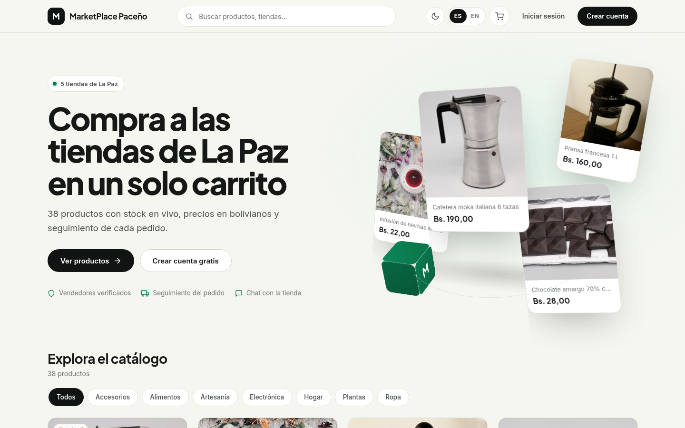
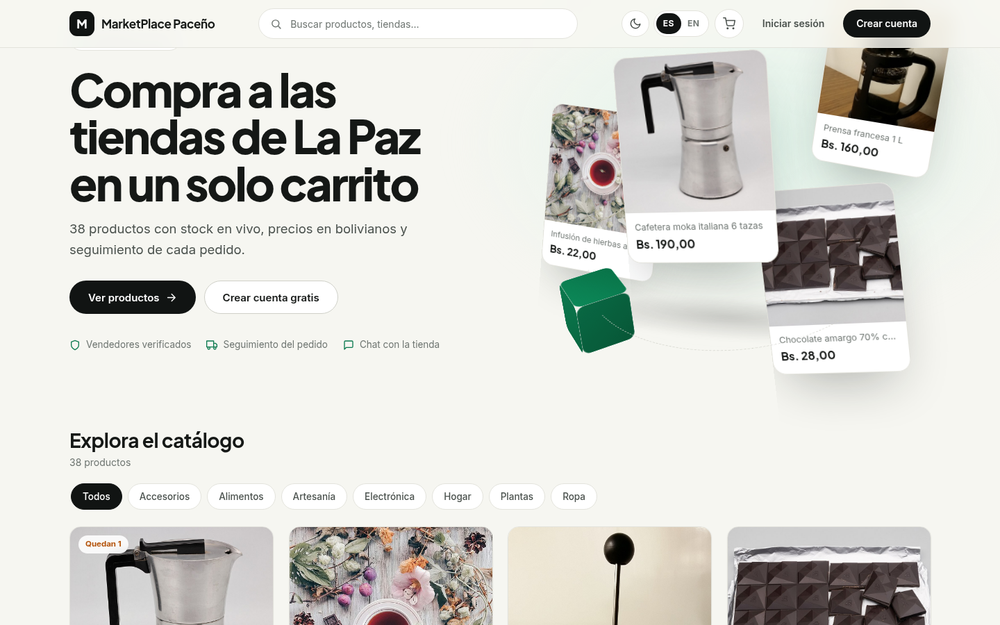
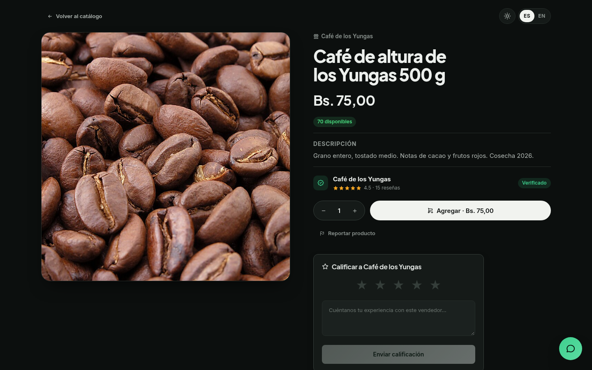
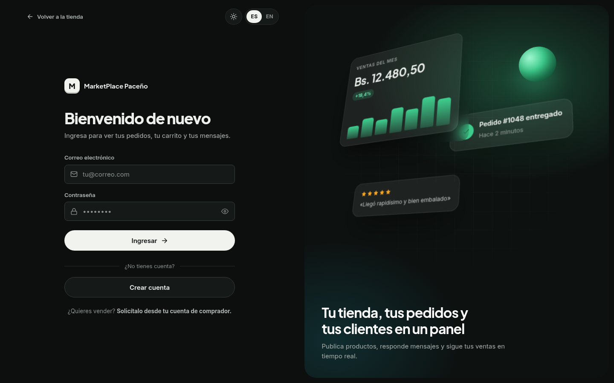
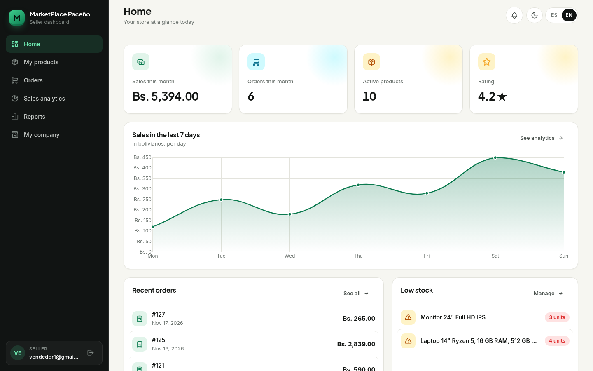
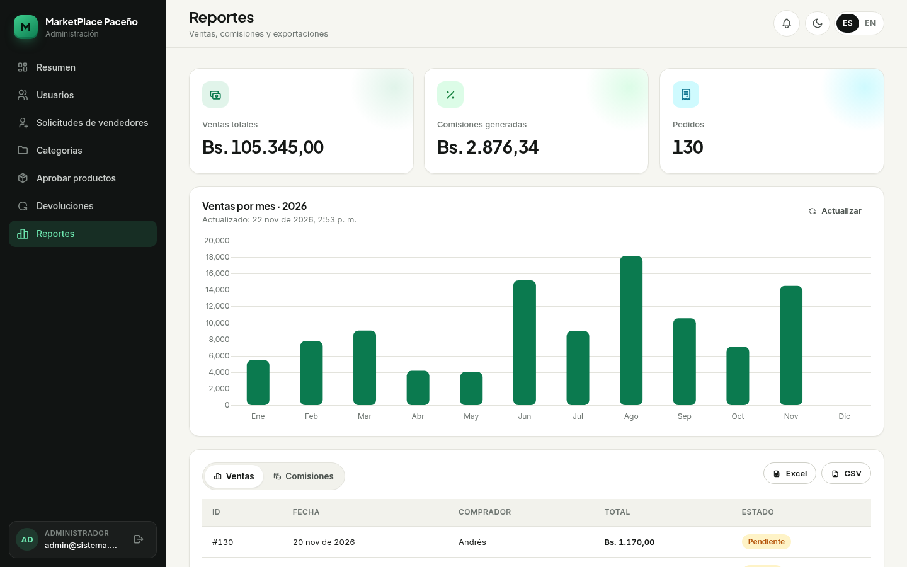
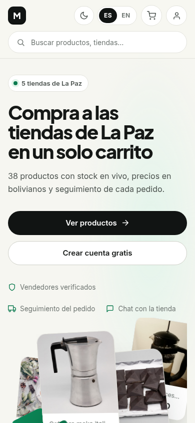

# MarketPlace Paceño — Sistema Vendedor

A multi-vendor web marketplace: stores from La Paz, Bolivia, list their products and shoppers buy from
all of them in a single cart. It has three roles, each with its own dashboard:
**shopper**, **seller** and **administrator**.

> University project for the **Taller Técnico Superior** course, led by
> [@amamemie](https://github.com/amamemie).

🇪🇸 [Leer en español](README.es.md)

### 👉 [See the live demo](https://amamemie.github.io/sistema-vendedor/)



## Contents

- [Live demo](#live-demo)
- [Features](#features)
- [Tech stack](#tech-stack)
- [Screenshots](#screenshots)
- [Getting started](#getting-started)
- [Test accounts](#test-accounts)
- [Project structure](#project-structure)
- [Database](#database)
- [Known limitations](#known-limitations)
- [Credits](#credits)

## Live demo

**<https://amamemie.github.io/sistema-vendedor/>**

The demo is hosted on GitHub Pages, which only serves static files, so it doesn't use the PHP backend.
Instead, it ships a copy of the demo data and a simulated backend that runs in the browser (`src/demo/`).

- You can try everything with the [test accounts](#test-accounts): catalog, cart, checkout and the
  shopper, seller and admin dashboards, with their charts and reports (including PDF and Excel export).
- Actions that change data (creating products, updating statuses, approving…) respond, but **are not saved**.
- Dates shift automatically, so recent activity always looks like it happened this week.

For the full version with a real database, see [Getting started](#getting-started).

The app's interface is available in Spanish and English: use the **ES / EN** switch in the header.

## Features

### Visitor (no account)
- Browse the public catalog, search products and filter by category.
- Build a cart. At checkout they're asked to sign in or sign up, and the cart is kept.

### Shopper
- Product details: photos, stock, description and the store's rating.
- Cart with quantities, discount codes, and checkout by card, QR code or bank transfer (payment is simulated).
- **My orders**: track each order's status, cancel pending orders and request returns.
- Rate sellers, report products and chat with the store.
- My reviews, my discounts, and an option to **apply to become a seller**.

### Seller
- Dashboard with monthly sales, orders, active products, rating and a 7-day sales chart.
- Product management: create, edit, delete, upload images and control stock.
- Incoming orders: mark them as *Shipped* or *Delivered* and chat with the buyer.
- Sales analytics: best-selling products, top customers (with the option to give them a discount) and most-cancelled products.
- Reports by date range, and company details.

### Administrator
- Platform overview: monthly revenue and orders, users, sellers and pending items.
- User management: change roles and **activate or deactivate accounts** (a deactivated account can't sign in).
- Seller list and **direct seller onboarding**, with their store already approved.
- Category management.
- Approve or reject products before they appear in the catalog.
- Approve or reject new seller applications and return requests.
- Sales and commission reports (3% per sale) with a monthly chart and **Excel** and **CSV** export.
- Detailed reports by date range (earnings, sellers, buyers and products sold) with **PDF** and Excel export.

### Across the app
- **Light and dark mode**: remembers the user's choice and follows the system setting the first time.
- **Spanish and English**: UI text, dates, currency and the headers of exported Excel files.
- **3D animations**: a 3D scene on the home and sign-in pages, cards that tilt with the mouse and
  modals that open with depth. They're turned off when the user has "reduce motion" enabled.
- **Responsive design**: works from 360 px wide, with a drawer menu on mobile.
- **Accessibility**: keyboard navigation with visible focus, a skip-to-content link and labelled buttons for screen readers.

## Tech stack

| Layer | Technology |
|---|---|
| Frontend | [React 19](https://react.dev) + [Vite 8](https://vite.dev) |
| Styling | Custom CSS with design tokens (CSS variables), no framework; Inter and Plus Jakarta Sans fonts; [Tabler](https://tabler.io/icons) icons |
| Languages | [i18next](https://www.i18next.com) + react-i18next, with automatic language detection |
| Charts | [Chart.js](https://www.chartjs.org) + react-chartjs-2 |
| Export | [SheetJS (xlsx)](https://sheetjs.com) + file-saver (Excel/CSV), [jsPDF](https://github.com/parallax/jsPDF) + jspdf-autotable (PDF) |
| Backend | PHP 8 (REST API as `.php` files returning JSON) with PDO |
| Database | MySQL / MariaDB |
| Local environment | XAMPP, or Docker with `docker-compose.yml` |
| Hosting (demo) | GitHub Pages, deployed with GitHub Actions |
| Code quality | ESLint (React Hooks and React Refresh rules) |

## Screenshots

| | |
|---|---|
|  |  |
| Catalog with category filters | Product details (dark mode) |
|  |  |
| Sign-in page with 3D panel | Seller dashboard (English) |
|  |  |
| Admin reports | Mobile view |

## Getting started

You need [Node.js 20+](https://nodejs.org) for the frontend and a PHP server with MySQL for the backend.
The frontend expects the API at `http://localhost/sistema-vendedor/backend`, so the project must be
served at that path.

### 1. Clone and install

```bash
git clone https://github.com/amamemie/sistema-vendedor.git
cd sistema-vendedor
npm install
```

### 2. Backend and database

**Option A — XAMPP (Windows)**

1. Copy or link the project folder to `C:\xampp\htdocs\sistema-vendedor`.
2. Start Apache and MySQL from the XAMPP control panel.
3. In phpMyAdmin, create the `sistema_ventas` database and import, in this order:
   1. `sistema_ventass.sql` (tables and base data)
   2. `backend/seed/datos_demo.sql` (demo data)
4. If your MySQL user has a password, set it in `backend/config.php`.

**Option B — Docker (Linux / macOS / Windows)**

```bash
docker compose up -d --build
```

This starts MariaDB, with both SQL files already imported, and PHP + Apache on port 80.
The database is only created the first time; run `docker compose down -v` to start from scratch.

> On Linux, MySQL table names are case-sensitive, and the code uses `PRODUCTO`, `COMPRA`, etc.
> That's why `docker-compose.yml` starts MariaDB with `--lower-case-table-names=1`. XAMPP on Windows doesn't need this.

Check that the backend responds: <http://localhost/sistema-vendedor/backend/categorias.php>

### 3. Frontend

```bash
npm run dev
```

Open <http://localhost:5173>.

Other commands:

```bash
npm run build          # build to dist/
npm run preview        # serve the production build
npm run lint           # check the code with ESLint
npm run build:demo     # build the static demo (no backend) for GitHub Pages
npm run preview:demo   # try the demo at http://localhost:4173/sistema-vendedor/
npm run demo:snapshot  # refresh the demo data from the local backend
```

### Deploying the demo to GitHub Pages

The `.github/workflows/deploy-pages.yml` workflow builds and publishes the demo on every push to `main`.
It only needs to be enabled once: **Settings → Pages → Build and deployment → Source: GitHub Actions**.

If the data or the backend endpoints change, run `npm run demo:snapshot` with the local backend running
and commit `src/demo/snapshot.json`.

## Test accounts

They're included in the demo data.

| Role | Email | Password |
|---|---|---|
| Administrator | `admin@sistema.com` | `hash_admin_123` |
| Seller (TecnoMundo) | `vendedor1@gmail.com` | `hash_vend_1` |
| Seller (ModaExpress) | `vendedor2@gmail.com` | `hash_vend_2` |
| Seller (Verde Andino) | `gabriela.rojas@ejemplo.com` | `123456` |
| Shopper | `comprador1@hotmail.com` | `hash_comp_1` |
| Shopper | `bien@gmail.com` | `123456` |

## Project structure

Folder and file names are in Spanish, as in the original project.

```
sistema-vendedor/
├── backend/                  PHP API (one file per endpoint)
│   ├── config.php            PDO connection and CORS headers
│   ├── productos.php, comprar.php, pedidos_vendedor.php, reporte_ventas.php, …
│   ├── seed/                 demo data generator
│   │   ├── generar_datos_demo.py
│   │   └── datos_demo.sql
│   └── uploads/productos/    product images (+ CREDITOS.md with photo credits)
├── src/
│   ├── components/
│   │   ├── auth/             sign-in screen with 3D scene
│   │   ├── layout/           AppShell: dashboard sidebar and top bar
│   │   ├── store/            header, product cards, cart drawer, 3D hero
│   │   └── ui/               3D Tilt, CountUp, Prefs (theme/language), toasts, icons
│   ├── context/              AuthContext (session) and ThemeContext (light/dark)
│   ├── demo/                 simulated backend and data for the GitHub Pages demo
│   ├── hooks/                useChat, useNotifications, useChartTheme…
│   ├── i18n/                 es.json, en.json and currency/date formatting
│   ├── pages/
│   │   ├── public/           public catalog
│   │   ├── comprador/        shopper: cart, checkout, profile, orders, reviews…
│   │   ├── vendor/           seller: dashboard, products, orders, analytics, reports
│   │   └── admin/            admin: overview, users, sellers, categories, approvals, reports
│   ├── router/               role-based navigation (with lazy loading)
│   ├── services/api.js       API client
│   └── styles/               tokens.css (colors and themes), components, dashboards
├── scripts/demo-snapshot.mjs builds src/demo/snapshot.json from the local backend
├── .github/workflows/        automatic deployment to GitHub Pages
├── docker/ and docker-compose.yml
├── sistema_ventass.sql       schema and base data
└── docs/capturas/            screenshots used in this README
```

## Database

The main tables are `cuenta_usuario` (accounts), `comprador` (shoppers), `vendedor` (sellers), `tienda` (stores),
`perfil_vendedor` (seller profiles), `categoria`, `producto`, `inventario` (stock), `compra` (orders),
`detalle_compra` (order lines), `pago` (payments), `comision` (commissions), `dispersion` (seller payouts),
`resena` (reviews and chat messages) and `reporte_producto` (product reports).

A sale flows through: `compra` → `detalle_compra` → `pago` → `comision` (3% for the platform)
→ `dispersion` (97% for the seller).

The **demo data** (`backend/seed/datos_demo.sql`) includes 7 stores, 42 products with photos,
16 shoppers, 130 orders from January to November 2026, payments, reviews, chats, returns and
pending seller applications. To regenerate it:

```bash
python3 backend/seed/generar_datos_demo.py
```

It always produces the same data (fixed random seed).

## Known limitations

This is an academic project. Before using it in production, these would need to be addressed:

- Shopper accounts are registered with **plain-text passwords**. Sign-in already accepts passwords hashed with `password_hash()` (used for sellers created by the admin), but registration doesn't hash them yet.
- There are no session tokens: the API trusts the IDs sent by the frontend.
- The backend URL (`http://localhost/sistema-vendedor/backend`) is hard-coded instead of coming from an environment variable.
- Payments are simulated, and discount codes are stored in a log file rather than in the database.
- Error messages returned by the backend are in Spanish only.

## Credits

- Project led by [@amamemie](https://github.com/amamemie) for the Taller Técnico Superior course.
- Demo product photos come from [Wikimedia Commons](https://commons.wikimedia.org) under CC0, CC BY and
  CC BY-SA licenses. Authors and licenses are listed in
  [`backend/uploads/productos/CREDITOS.md`](backend/uploads/productos/CREDITOS.md).
- Icons: [Tabler Icons](https://tabler.io/icons) (MIT).
